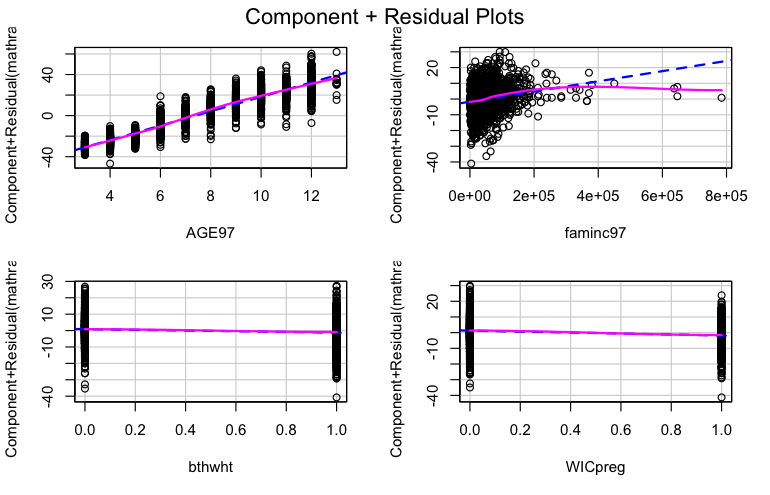
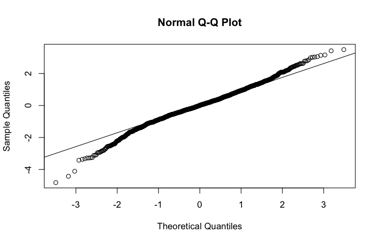
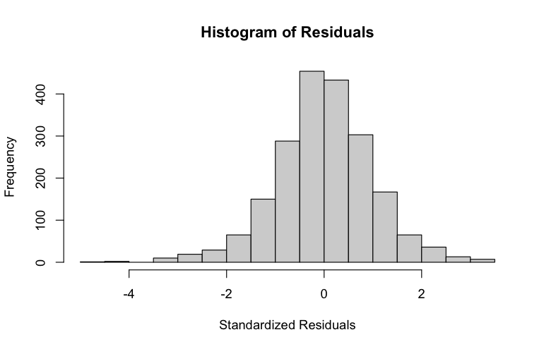
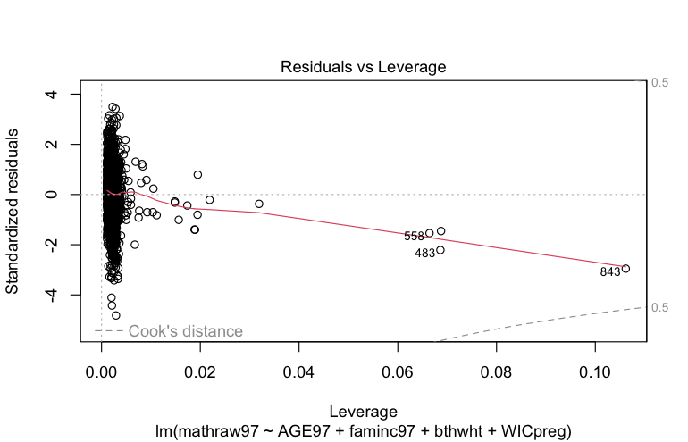
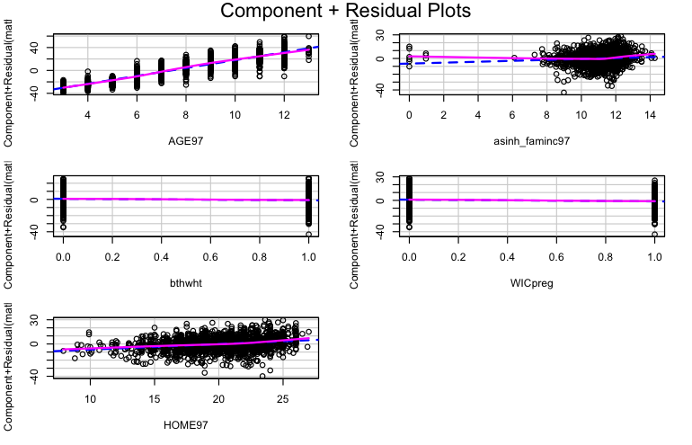
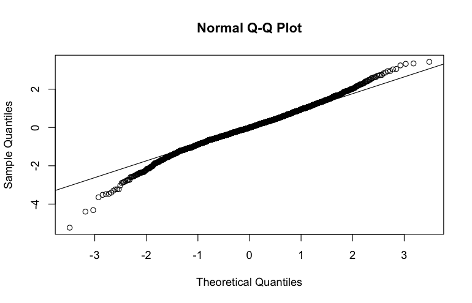

Baseline OLS, full assumption diagnostics (linearity, Breusch–Pagan/White heteroskedasticity tests, normality, influence), then a revised model with asinh-transformed income, home-environment score and HC3 robust standard errors. Full write-up: [report](../reports/02_WIC_math_achievement_diagnostics.pdf).


``` r
good <- read.csv('../data/good.csv')
library(dplyr)
library(car)          
library(ggplot2)
library(psych)
library(lmtest)  
library(sandwich) 
library(tidyr)
library(stargazer)
vars_needed <- c("mathraw97","AGE97","faminc97","bthwht","WICpreg","HOME97")
df_core <- good %>%
  select(all_of(vars_needed)) %>%
  mutate(across(everything(), as.numeric))
```


``` r
# Numeric descriptives
desc <- describe(df_core %>% select(mathraw97, AGE97, faminc97, HOME97))

# Binary counts and proportions
table(df_core$WICpreg, useNA = "ifany")
```

```
## 
##    0    1 <NA> 
## 1882 1440  241
```

``` r
prop.table(table(df_core$WICpreg, useNA = "ifany"))
```

```
## 
##          0          1       <NA> 
## 0.52820657 0.40415380 0.06763963
```

``` r
table(df_core$bthwht, useNA = "ifany")
```

```
## 
##    0    1 
## 2180 1383
```

``` r
prop.table(table(df_core$bthwht, useNA = "ifany"))
```

```
## 
##        0        1 
## 0.611844 0.388156
```

``` r
# Correlations
pair_cor <- cor(df_core %>% select(mathraw97, AGE97, faminc97, HOME97),
    use = "pairwise.complete.obs")
```


``` r
desc_t <- desc %>%
  mutate(Variable = rownames(desc)) %>%
  select(Variable, everything()) %>%
  pivot_longer(
    cols = -Variable,
    names_to = "Statistic",
    values_to = "Value"
  ) %>%
  pivot_wider(names_from = Variable, values_from = Value)
print(desc_t)
```

```
## # A tibble: 13 x 5
##    Statistic mathraw97     AGE97  faminc97    HOME97
##    <chr>         <dbl>     <dbl>     <dbl>     <dbl>
##  1 vars          1        2           3       4     
##  2 n          2211     2223        3563    3563     
##  3 mean         36.3      7.47    49841.     18.9   
##  4 sd           22.3      2.93    49751.      3.62  
##  5 median       37        7       39118.     19.2   
##  6 trimmed      35.8      7.45    42476.     19.0   
##  7 mad          29.7      4.45    31740.      4.15  
##  8 min           0        3      -72296.      7     
##  9 max          98       13      784611.     27     
## 10 range        98       10      856907.     20     
## 11 skew          0.123    0.0435      4.67   -0.259 
## 12 kurtosis     -1.12    -1.25       43.3    -0.585 
## 13 se            0.474    0.0622    833.      0.0607
```


``` r
df_base <- df_core %>% drop_na(mathraw97, AGE97, faminc97, bthwht, WICpreg)
m_base <- lm(mathraw97 ~ AGE97 + faminc97 + bthwht + WICpreg, data = df_base)
summary(m_base)
```

```
## 
## Call:
## lm(formula = mathraw97 ~ AGE97 + faminc97 + bthwht + WICpreg, 
##     data = df_base)
## 
## Residuals:
##     Min      1Q  Median      3Q     Max 
## -39.478  -4.573   0.087   4.994  28.613 
## 
## Coefficients:
##               Estimate Std. Error t value Pr(>|t|)    
## (Intercept) -1.555e+01  5.863e-01 -26.517  < 2e-16 ***
## AGE97        7.013e+00  6.394e-02 109.683  < 2e-16 ***
## faminc97     3.238e-05  3.707e-06   8.733  < 2e-16 ***
## bthwht      -2.149e+00  3.826e-01  -5.616 2.22e-08 ***
## WICpreg     -3.113e+00  4.023e-01  -7.737 1.59e-14 ***
## ---
## Signif. codes:  0 '***' 0.001 '**' 0.01 '*' 0.05 '.' 0.1 ' ' 1
## 
## Residual standard error: 8.204 on 2037 degrees of freedom
## Multiple R-squared:  0.8648,	Adjusted R-squared:  0.8645 
## F-statistic:  3257 on 4 and 2037 DF,  p-value: < 2.2e-16
```


``` r
# Linearity (component + residual plots)
crPlots(m_base)
```



``` r
# Heteroskedasticity (Breusch–Pagan and White tests)
bp1 <- bptest(m_base)                                         
bp2 <- bptest(m_base, ~ fitted(m_base) + I(fitted(m_base)^2)) 
bp_results <- data.frame(
  Test = c("Breusch-Pagan", "White Test"),
  BP = c(bp1$statistic, bp2$statistic),
  df = c(bp1$parameter, bp2$parameter),
  p_value = c(bp1$p.value, bp2$p.value)
)
print(bp_results)
```

```
##            Test       BP df      p_value
## 1 Breusch-Pagan 164.9294  4 1.280940e-34
## 2    White Test 157.7684  2 5.508342e-35
```

``` r
# Normality of residuals
qqnorm(rstandard(m_base)); qqline(rstandard(m_base))
```



``` r
hist(rstandard(m_base), main="Histogram of Residuals", xlab="Standardized Residuals")
```



``` r
# Outliers and influence
summary(influence.measures(m_base))
```

```
## Potentially influential observations of
## 	 lm(formula = mathraw97 ~ AGE97 + faminc97 + bthwht + WICpreg,      data = df_base) :
## 
##      dfb.1_ dfb.AGE9 dfb.fm97 dfb.bthw dfb.WICp dffit   cov.r   cook.d hat    
## 61    0.02   0.02     0.02    -0.04    -0.03     0.09    0.99_*  0.00   0.00  
## 109   0.02  -0.01    -0.04    -0.01    -0.01    -0.04    1.02_*  0.00   0.01_*
## 137  -0.06   0.10    -0.01     0.06    -0.05     0.15_*  0.99_*  0.00   0.00  
## 138   0.06  -0.02    -0.01    -0.03    -0.04     0.08    0.99_*  0.00   0.00  
## 146  -0.02   0.05    -0.02    -0.07     0.07     0.12    0.99_*  0.00   0.00  
## 161  -0.01   0.07     0.01    -0.06    -0.04     0.13    0.98_*  0.00   0.00  
## 169  -0.04  -0.04     0.07     0.05     0.06    -0.11    0.99_*  0.00   0.00  
## 177  -0.02   0.06     0.02    -0.05    -0.02     0.11    0.99_*  0.00   0.00  
## 198   0.05   0.00    -0.06    -0.08    -0.09    -0.15_*  0.98_*  0.00   0.00  
## 228   0.06  -0.03    -0.05     0.08    -0.07     0.12    0.99_*  0.00   0.00  
## 231   0.02   0.02     0.02    -0.04    -0.03     0.09    0.99_*  0.00   0.00  
## 245  -0.06   0.04     0.03    -0.07     0.06    -0.11    0.99_*  0.00   0.00  
## 254   0.09  -0.05    -0.13    -0.05    -0.01    -0.16_*  1.00    0.01   0.01  
## 281   0.02   0.00    -0.07     0.01    -0.01    -0.07    1.01_*  0.00   0.01_*
## 282   0.01   0.02    -0.08     0.00    -0.02    -0.09    1.01_*  0.00   0.01_*
## 283   0.03  -0.12     0.02     0.09     0.06    -0.19_*  0.96_*  0.01   0.00  
## 318   0.00   0.00    -0.02     0.00     0.00    -0.02    1.01_*  0.00   0.01  
## 351   0.00   0.02    -0.02    -0.02     0.00    -0.03    1.01_*  0.00   0.01  
## 352   0.00   0.01    -0.01    -0.01     0.00    -0.01    1.01_*  0.00   0.01  
## 356  -0.03   0.06     0.07    -0.06    -0.01     0.14    0.98_*  0.00   0.00  
## 379  -0.06   0.03     0.09     0.03     0.01     0.11    1.01    0.00   0.01_*
## 403   0.00  -0.02     0.04     0.00     0.00     0.04    1.01_*  0.00   0.01_*
## 411   0.01  -0.08     0.07    -0.06     0.07    -0.15_*  0.99_*  0.00   0.00  
## 450   0.05   0.00    -0.04    -0.04    -0.05     0.09    0.99_*  0.00   0.00  
## 478  -0.04   0.08    -0.02     0.07    -0.06     0.15_*  0.98_*  0.00   0.00  
## 482   0.17  -0.02    -0.39     0.01    -0.13    -0.40_*  1.07_*  0.03   0.07_*
## 483   0.24  -0.01    -0.60     0.00    -0.19    -0.60_*  1.06_*  0.07   0.07_*
## 491  -0.05   0.03     0.13    -0.03     0.02     0.15_*  1.00    0.00   0.00  
## 519   0.01   0.01    -0.02     0.08    -0.06     0.12    0.99_*  0.00   0.00  
## 553  -0.03   0.05     0.05    -0.05    -0.01     0.11    0.99_*  0.00   0.00  
## 558   0.17  -0.02    -0.41     0.01    -0.13    -0.41_*  1.07_*  0.03   0.07_*
## 559   0.08  -0.02    -0.19     0.02    -0.05    -0.19_*  1.02_*  0.01   0.02_*
## 560   0.05   0.02    -0.19     0.01    -0.05    -0.19_*  1.02_*  0.01   0.02_*
## 597   0.01   0.03     0.00    -0.04    -0.03     0.08    0.99_*  0.00   0.00  
## 603   0.01   0.02    -0.05     0.00    -0.01    -0.06    1.02_*  0.00   0.02_*
## 690  -0.08   0.09     0.07     0.08    -0.04     0.18_*  0.98_*  0.01   0.00  
## 691  -0.01   0.03     0.04    -0.04    -0.02     0.09    0.99_*  0.00   0.00  
## 723  -0.02  -0.04     0.02     0.06     0.05    -0.11    0.98_*  0.00   0.00  
## 732  -0.01   0.06     0.02    -0.05    -0.03     0.11    0.99_*  0.00   0.00  
## 738   0.08  -0.02    -0.07    -0.04    -0.07     0.11    0.99_*  0.00   0.00  
## 743   0.07  -0.02    -0.03    -0.04    -0.05     0.09    0.99_*  0.00   0.00  
## 782  -0.02   0.03     0.06    -0.04    -0.01     0.11    0.99_*  0.00   0.00  
## 786   0.05   0.02    -0.05    -0.05    -0.06     0.10    0.99_*  0.00   0.00  
## 798   0.02   0.01     0.01    -0.04    -0.03     0.08    0.99_*  0.00   0.00  
## 802  -0.03  -0.01     0.06    -0.07     0.08    -0.13    0.99_*  0.00   0.00  
## 807   0.00   0.02    -0.05     0.00    -0.01    -0.06    1.01_*  0.00   0.01_*
## 808  -0.04   0.01     0.11    -0.01     0.03     0.11    1.02_*  0.00   0.02_*
## 809   0.03   0.01    -0.11     0.01    -0.03    -0.11    1.02_*  0.00   0.02_*
## 811  -0.02   0.00     0.05    -0.01     0.01     0.06    1.01_*  0.00   0.01_*
## 816  -0.04   0.02     0.09    -0.02     0.02     0.10    1.01_*  0.00   0.01_*
## 817   0.00   0.03    -0.06     0.00    -0.01    -0.07    1.01_*  0.00   0.01_*
## 843   0.32   0.11    -1.01_*  -0.03    -0.32    -1.02_*  1.10_*  0.21   0.11_*
## 851  -0.04   0.08    -0.02     0.06    -0.06     0.14    0.99_*  0.00   0.00  
## 855   0.04  -0.09    -0.01     0.06     0.03    -0.12    0.99_*  0.00   0.00  
## 910   0.02  -0.14     0.05     0.10     0.07    -0.20_*  0.96_*  0.01   0.00  
## 951   0.03  -0.07     0.03    -0.05     0.05    -0.12    0.99_*  0.00   0.00  
## 953   0.00   0.00     0.00     0.00     0.00     0.01    1.01_*  0.00   0.01  
## 954   0.01   0.04     0.01    -0.06    -0.04     0.11    0.98_*  0.00   0.00  
## 955  -0.02   0.09    -0.07     0.06    -0.08     0.17_*  0.98_*  0.01   0.00  
## 1025 -0.03   0.08     0.02    -0.06    -0.03     0.13    0.98_*  0.00   0.00  
## 1056  0.01   0.00    -0.03     0.00    -0.01    -0.03    1.02_*  0.00   0.01_*
## 1057  0.02   0.03    -0.12     0.00    -0.03    -0.13    1.02_*  0.00   0.02_*
## 1060  0.03   0.00    -0.07    -0.01    -0.02    -0.07    1.04_*  0.00   0.03_*
## 1080  0.05  -0.06     0.03    -0.06    -0.06    -0.14    0.98_*  0.00   0.00  
## 1081  0.13  -0.16     0.05    -0.07    -0.10    -0.26_*  0.95_*  0.01   0.00  
## 1164  0.05  -0.07     0.05     0.12    -0.06     0.17_*  0.97_*  0.01   0.00  
## 1169 -0.03   0.01     0.04    -0.06     0.06    -0.10    0.99_*  0.00   0.00  
## 1175  0.01  -0.10     0.10    -0.07     0.10    -0.19_*  0.98_*  0.01   0.00  
## 1256  0.00  -0.01     0.02     0.01     0.01     0.02    1.01_*  0.00   0.01_*
## 1272  0.07  -0.08     0.02    -0.04    -0.05    -0.14    0.99_*  0.00   0.00  
## 1273  0.09  -0.09     0.00    -0.04    -0.07    -0.15    0.99_*  0.00   0.00  
## 1301  0.06  -0.06     0.01    -0.04    -0.06    -0.12    0.99_*  0.00   0.00  
## 1322  0.01  -0.08     0.04     0.06     0.04    -0.12    0.99_*  0.00   0.00  
## 1334  0.01  -0.07     0.00     0.07     0.04    -0.13    0.98_*  0.00   0.00  
## 1396 -0.08   0.05     0.06    -0.08     0.08    -0.13    0.99_*  0.00   0.00  
## 1404  0.06  -0.08    -0.03    -0.07     0.04    -0.14    0.99_*  0.00   0.00  
## 1409  0.01  -0.09     0.09    -0.07     0.09    -0.19_*  0.98_*  0.01   0.00  
## 1441  0.10  -0.12     0.01    -0.04    -0.07    -0.17_*  0.98_*  0.01   0.00  
## 1465  0.03  -0.07     0.03    -0.06     0.06    -0.13    0.99_*  0.00   0.00  
## 1467  0.07  -0.08     0.01    -0.04    -0.06    -0.13    0.99_*  0.00   0.00  
## 1468  0.00   0.05    -0.01    -0.05    -0.03     0.09    0.99_*  0.00   0.00  
## 1481  0.04  -0.07     0.01     0.07    -0.07    -0.12    0.99_*  0.00   0.00  
## 1507  0.04  -0.04     0.02    -0.05    -0.05    -0.12    0.99_*  0.00   0.00  
## 1546 -0.14   0.10     0.09     0.06     0.11     0.19_*  0.98_*  0.01   0.00  
## 1554  0.07  -0.09     0.02    -0.04    -0.06    -0.14    0.99_*  0.00   0.00  
## 1560  0.04   0.00     0.01    -0.04    -0.04     0.08    0.99_*  0.00   0.00  
## 1575  0.13  -0.11    -0.07    -0.06    -0.11    -0.19_*  0.98_*  0.01   0.00  
## 1605 -0.02   0.00     0.01     0.05     0.06     0.10    0.99_*  0.00   0.00  
## 1681  0.08  -0.10     0.02    -0.05    -0.07    -0.16_*  0.98_*  0.00   0.00  
## 1683  0.03  -0.08     0.04    -0.06     0.06    -0.14    0.99_*  0.00   0.00  
## 1707  0.01   0.00    -0.03    -0.01    -0.01    -0.03    1.02_*  0.00   0.02_*
## 1720  0.06  -0.07    -0.06     0.06    -0.09    -0.13    0.99_*  0.00   0.00  
## 1723  0.03  -0.07     0.03     0.07    -0.06    -0.12    0.99_*  0.00   0.00  
## 1730  0.01  -0.04     0.02     0.07    -0.08    -0.13    0.98_*  0.00   0.00  
## 1733 -0.06  -0.02     0.07     0.05     0.07    -0.12    0.99_*  0.00   0.00  
## 1748  0.08  -0.08     0.01    -0.04    -0.06    -0.14    0.99_*  0.00   0.00  
## 1770  0.06  -0.08    -0.03    -0.07     0.05    -0.16_*  0.98_*  0.00   0.00  
## 1771  0.01  -0.07     0.07    -0.05     0.07    -0.14    0.99_*  0.00   0.00  
## 1791 -0.05   0.07    -0.03     0.04     0.05     0.13    0.99_*  0.00   0.00  
## 1865  0.04  -0.10     0.03    -0.08     0.07    -0.17_*  0.98_*  0.01   0.00  
## 1913  0.08  -0.08    -0.06    -0.05     0.02    -0.14    0.99_*  0.00   0.00  
## 1918  0.00   0.03    -0.07    -0.04     0.00    -0.08    1.01_*  0.00   0.01_*
## 1921  0.02  -0.10     0.00     0.07     0.04    -0.15    0.98_*  0.00   0.00  
## 1963  0.01  -0.07     0.01     0.05     0.03    -0.10    0.99_*  0.00   0.00  
## 1964  0.03  -0.06     0.00    -0.08     0.06    -0.14    0.98_*  0.00   0.00  
## 1971  0.00  -0.01    -0.01     0.05    -0.07    -0.10    0.99_*  0.00   0.00  
## 2012 -0.04   0.04     0.00     0.05     0.06     0.11    0.99_*  0.00   0.00  
## 2017 -0.02   0.03    -0.04    -0.08     0.04    -0.11    0.99_*  0.00   0.00
```

``` r
plot(m_base, which = 5)  
```



``` r
n <- nobs(m_base)
which(cooks.distance(m_base) > 4/n)
```

```
##   93  137  146  161  169  177  180  198  228  245  254  259  283  356  379  411 
##   93  137  146  161  169  177  180  198  228  245  254  259  283  356  379  411 
##  457  463  478  482  483  484  491  519  553  558  559  560  586  642  675  690 
##  457  463  478  482  483  484  491  519  553  558  559  560  586  642  675  690 
##  719  723  732  738  765  782  786  802  806  808  809  816  843  848  851  855 
##  719  723  732  738  765  782  786  802  806  808  809  816  843  848  851  855 
##  860  910  951  954  955  978 1025 1053 1057 1076 1080 1081 1146 1164 1169 1175 
##  860  910  951  954  955  978 1025 1053 1057 1076 1080 1081 1146 1164 1169 1175 
## 1272 1273 1295 1301 1310 1322 1334 1396 1404 1409 1441 1457 1465 1467 1473 1481 
## 1272 1273 1295 1301 1310 1322 1334 1396 1404 1409 1441 1457 1465 1467 1473 1481 
## 1484 1491 1507 1535 1546 1554 1575 1578 1605 1634 1670 1677 1681 1683 1717 1720 
## 1484 1491 1507 1535 1546 1554 1575 1578 1605 1634 1670 1677 1681 1683 1717 1720 
## 1723 1730 1733 1748 1770 1771 1791 1845 1865 1874 1913 1921 1963 1964 1969 2012 
## 1723 1730 1733 1748 1770 1771 1791 1845 1865 1874 1913 1921 1963 1964 1969 2012 
## 2017 
## 2017
```


``` r
df_rev <- df_core %>%
  drop_na(mathraw97, AGE97, faminc97, bthwht, WICpreg, HOME97) %>%
  mutate(asinh_faminc97 = asinh(faminc97))

m_rev <- lm(mathraw97 ~ AGE97 + asinh_faminc97 + bthwht + WICpreg + HOME97, data = df_rev)
summary(m_rev)
```

```
## 
## Call:
## lm(formula = mathraw97 ~ AGE97 + asinh_faminc97 + bthwht + WICpreg + 
##     HOME97, data = df_rev)
## 
## Residuals:
##     Min      1Q  Median      3Q     Max 
## -42.086  -4.668  -0.048   4.859  27.602 
## 
## Coefficients:
##                 Estimate Std. Error t value Pr(>|t|)    
## (Intercept)    -33.80487    2.06491 -16.371  < 2e-16 ***
## AGE97            6.89321    0.06411 107.529  < 2e-16 ***
## asinh_faminc97   0.58447    0.17123   3.413 0.000654 ***
## bthwht          -1.93417    0.37708  -5.129 3.18e-07 ***
## WICpreg         -2.23675    0.41383  -5.405 7.24e-08 ***
## HOME97           0.68770    0.06860  10.025  < 2e-16 ***
## ---
## Signif. codes:  0 '***' 0.001 '**' 0.01 '*' 0.05 '.' 0.1 ' ' 1
## 
## Residual standard error: 8.066 on 2036 degrees of freedom
## Multiple R-squared:  0.8694,	Adjusted R-squared:  0.869 
## F-statistic:  2710 on 5 and 2036 DF,  p-value: < 2.2e-16
```

``` r
# Robust (HC3) standard errors
cov_hc3 <- vcovHC(m_rev, type = "HC3")
coeftest(m_rev, vcov. = cov_hc3)
```

```
## 
## t test of coefficients:
## 
##                  Estimate Std. Error  t value  Pr(>|t|)    
## (Intercept)    -33.804867   2.469911 -13.6867 < 2.2e-16 ***
## AGE97            6.893209   0.064466 106.9277 < 2.2e-16 ***
## asinh_faminc97   0.584471   0.211828   2.7592  0.005847 ** 
## bthwht          -1.934167   0.374221  -5.1685 2.590e-07 ***
## WICpreg         -2.236749   0.427159  -5.2363 1.807e-07 ***
## HOME97           0.687701   0.071539   9.6130 < 2.2e-16 ***
## ---
## Signif. codes:  0 '***' 0.001 '**' 0.01 '*' 0.05 '.' 0.1 ' ' 1
```

``` r
# Diagnostics again
crPlots(m_rev)
```



``` r
bp_r_1 <- bptest(m_rev)
bp_r_2 <- bptest(m_rev, ~ fitted(m_rev) + I(fitted(m_rev)^2))
bp_results_2 <- data.frame(
  Test = c("Breusch-Pagan", "White Test"),
  BP = c(bp_r_1$statistic, bp_r_2$statistic),
  df = c(bp_r_1$parameter, bp_r_2$parameter),
  p_value = c(bp_r_1$p.value, bp_r_2$p.value)
)
print(bp_results_2)
```

```
##            Test       BP df      p_value
## 1 Breusch-Pagan 155.8119  5 7.725533e-32
## 2    White Test 143.5524  2 6.729717e-32
```

``` r
qqnorm(rstandard(m_rev)); qqline(rstandard(m_rev))
```




``` r
summary(m_base)$r.squared
```

```
## [1] 0.8647904
```

``` r
summary(m_rev)$r.squared
```

```
## [1] 0.8693528
```

``` r
summary(m_base)$adj.r.squared
```

```
## [1] 0.8645249
```

``` r
summary(m_rev)$adj.r.squared
```

```
## [1] 0.869032
```

``` r
anova(m_base, m_rev)  # Model comparison (nested F-test)
```

```
## Analysis of Variance Table
## 
## Model 1: mathraw97 ~ AGE97 + faminc97 + bthwht + WICpreg
## Model 2: mathraw97 ~ AGE97 + asinh_faminc97 + bthwht + WICpreg + HOME97
##   Res.Df    RSS Df Sum of Sq      F    Pr(>F)    
## 1   2037 137086                                  
## 2   2036 132460  1    4625.8 71.101 < 2.2e-16 ***
## ---
## Signif. codes:  0 '***' 0.001 '**' 0.01 '*' 0.05 '.' 0.1 ' ' 1
```
